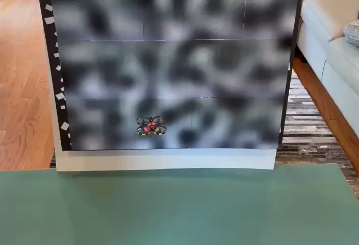
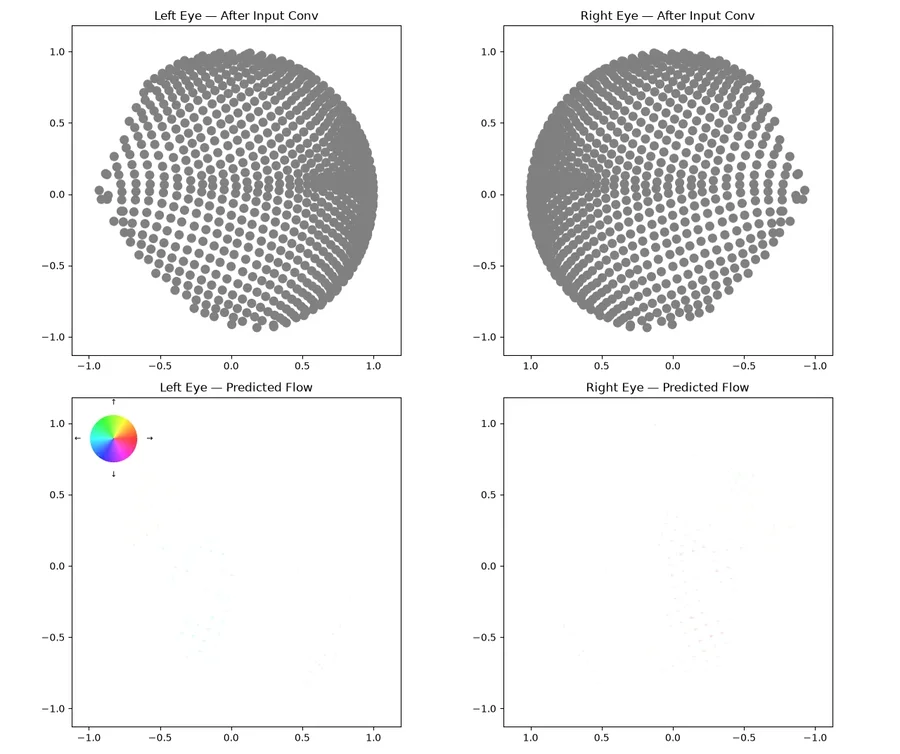

# Drosophila connectome models

<p align="center">
  
  <br>
  <em>Synthetic drosophila brain in a drone using dense optic flow to do visual stabilization</em>
</p>

<p align="center">
  
  <br>
  <em>Predicted optic flow to a randomly rotating filtered natural scene</em>
</p>

This repository is for specifying and training models of the *Drosophila*
nervous system in PyTorch. Each model is a recurrent network whose neurons and
signed synapses come from the FlyWire connectome; only per-cell-type parameters,
such as gains, time constants and input filters, are learned. The default
configuration trains the right optic lobe to report optic flow and ego-motion
from visual input.

## Setup

**Recommended hardware:** with default settings, a training run takes about
an hour on an NVIDIA A40 GPU and uses about 17 GB of GPU memory. Memory
scales with `[training].batch_size` (32 by default).

1. Download the code:
   ```bash
    git clone https://github.com/Nondairy-Creamer/drosophila_model.git
    cd drosophila_model
   ```
2. Set up a Python environment (Python 3.11 or newer) and activate it, for
   example:
   ```bash
    python -m venv .venv
    source .venv/bin/activate   # Windows (Git Bash): source .venv/Scripts/activate
   ```

    To train on a GPU, install the [PyTorch](https://pytorch.org) build for
    your CUDA version now. Otherwise the next step installs the CPU build.
3. Run the setup script:
   ```bash
    bash setup.sh   # Windows (PowerShell): & "C:\Program Files\Git\bin\bash.exe" setup.sh
   ```

    It installs the dependencies, downloads the data (about 250 MB) and prepares
    the training sets (a few minutes). The data go to `../drosophila_model_data`,
    next to the repo, unless you pass another folder: `bash setup.sh /path/to/data`.

## Train a model

Run all commands from the repo root.

```bash
python -m drosophila_model.training.train
```

This trains with the default settings and saves the run in `models/<timestamp>/`,
including the best model (`model.pt`) and a loss plot
(`figures/training/loss.png`).

To train several models on different seeds, across all your GPUs:

```bash
python -m drosophila_model.training.launch_runs --runs-per-gpu 2
```

## Change the settings

The defaults are in
[`config_default.toml`](drosophila_model/config_default.toml) (model and training)
and [`config_default_data.toml`](drosophila_model/config_default_data.toml)
(stimuli). To overwrite them, write the keys you want to change, with their new
values, in a `config.toml` or `config_data.toml` at the repo root. `setup.sh`
already creates `config.toml`. For example:

```toml
[training]
num_epochs = 100
```

## Analyze a model

Analysis scripts take a run folder and save their figures in
`<run>/figures/<analysis_name>/`. To run the standard set of tests:

```bash
python -m drosophila_model.analysis.model_analysis.benchmark_model models/<run>
```

To make the flow movie shown above:

```bash
python -m drosophila_model.analysis.movie_scripts.run_model_on_stimulus models/<run> --stim-type random_pano --input-conv --duration 10
```

## More detail

- [Reference](docs/reference.md): the data pipeline, every training tool and
  option, every analysis script, and the code layout
- [Model internals](model_architecture.md)
- [Coordinate and flow sign conventions](coordinate_conventions.md)
- [Derivations (LyX)](math/)
